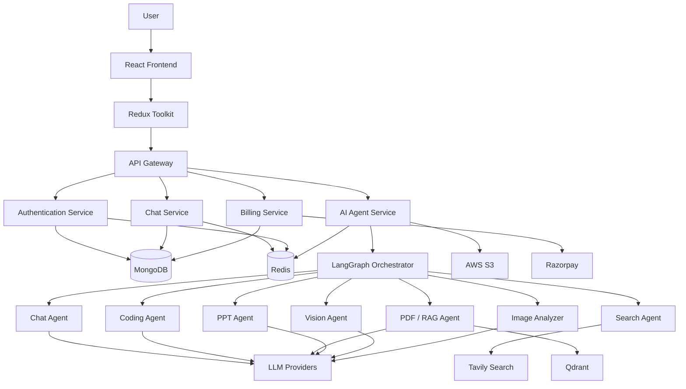

# ✨ NexoraAI — Your Intelligent Multi-Agent AI Assistant

<p align="center">
  <strong>One Platform. Multiple AI Agents. Limitless Possibilities.</strong>
</p>

NexoraAI is an AI-powered multi-agent assistant designed to handle everyday conversations, coding tasks, web searches, document generation, PDF understanding, and image analysis through a unified interface.

Built using React, Node.js, LangChain, LangGraph, and multiple AI model providers, NexoraAI uses an agent-based architecture to route user requests to specialized AI agents.

---

## 🚀 Features

### 🤖 Multi-Agent AI System

NexoraAI uses LangGraph to orchestrate specialized agents based on user requests.

| Agent | Functionality |
|---|---|
| Auto Agent | Automatically routes requests to an appropriate agent |
| Chat Agent | General conversations, explanations, and contextual responses |
| Coding Agent | Code generation, debugging, optimization, and code explanations |
| Search Agent | Web search and access to current information |
| PDF Agent | Generates downloadable PDF documents |
| PDF RAG Agent | Answers questions using the contents of uploaded PDFs |
| PPT Agent | Generates downloadable PowerPoint presentations |
| Vision Agent | Generates images from user prompts |
| Image Analyzer | Analyzes uploaded images and extracts information |

### 💬 Intelligent Chat

- Interactive AI-powered conversations.
- Persistent conversation history.
- Context-aware responses.
- Redis-based conversation memory.
- Markdown-formatted responses.

### 💻 AI Coding Assistant

- Generate code and project files.
- Debug existing code.
- Explain programming concepts.
- Review and optimize code.
- Display generated code artifacts.

### 🔍 AI-Powered Web Search

- Search the web using Tavily.
- Retrieve relevant search results.
- Include image results.
- Generate contextual responses based on search results.

### 📄 PDF Generation & Understanding

- Generate downloadable PDF documents.
- Upload PDF files.
- Extract text from uploaded documents.
- Split documents into smaller chunks.
- Generate embeddings.
- Retrieve relevant document sections using vector similarity search.
- Answer questions using Retrieval-Augmented Generation (RAG).

### 📊 PowerPoint Generation

- Generate structured presentation content.
- Automatically create presentation slides.
- Export presentations as downloadable PPTX files.

### 👁️ Image Intelligence

- Upload images for AI-powered analysis.
- Extract text from images.
- Understand charts, tables, and visual information.
- Generate images using AI-assisted prompts.

### 🔐 Authentication & User Management

- Firebase Authentication integration.
- Firebase Admin token verification.
- Session-based authentication.
- HTTP-only session cookies.
- User management using MongoDB.

### 💳 Credit-Based Subscription System

- Free plan with 100 credits.
- Starter plan: ₹199 with 500 credits.
- Pro plan: ₹499 with 1,000 credits.
- Razorpay payment integration.
- Payment signature verification.
- Automatic credit deduction based on agent usage.

### ☁️ Cloud Storage

- AWS S3 integration.
- Upload generated documents and images.
- Generate secure, time-limited download URLs.

---

## 🛠️ Tech Stack

### Frontend

- React 19
- Vite
- Tailwind CSS 4
- Redux Toolkit
- React Redux
- Axios
- Firebase
- Motion
- Lucide React
- React Markdown
- Monaco Editor

### Backend

- Node.js
- Express.js 5
- MongoDB
- Mongoose
- Redis
- Docker

### AI & Machine Learning Integration

- LangChain
- LangGraph
- Groq
- Google Gemini
- OpenRouter
- Tavily Search
- Qdrant Vector Database
- Google Generative AI Embeddings

### Cloud & Payments

- AWS S3
- AWS SDK
- Razorpay
- Firebase Admin SDK

### Development Tools

- Git
- GitHub
- Nodemon
- Docker Compose
- Vite

---

## 🏗️ System Architecture

NexoraAI follows a microservices-based backend architecture with a centralized API Gateway.



### Architecture Components

**1. Frontend**

The React application provides the user interface, handles user interactions, manages application state through Redux Toolkit, and communicates with backend APIs using Axios.

**2. API Gateway**

The gateway acts as the central entry point for incoming requests. It handles authentication middleware and routes requests to the appropriate microservice.

**3. Authentication Service**

Responsible for verifying Firebase ID tokens, creating user records, and managing Redis-backed sessions.

**4. Chat Service**

Manages conversations, messages, and conversation history using MongoDB.

**5. Agent Service**

The core AI service. It uses LangGraph to route requests to specialized agents and integrates with multiple AI providers and external services.

**6. Billing Service**

Handles subscription orders, Razorpay payment verification, and credit-related operations.

**7. Redis**

Used for session management, conversation memory caching, and agent rate limiting.

**8. MongoDB**

Stores user information, conversations, messages, and payment records.

**9. Qdrant**

Provides vector similarity search for document retrieval in the PDF RAG pipeline.

**10. AWS S3**

Stores generated files and provides temporary signed download URLs.

---

## 🔄 How NexoraAI Works

1. The user signs in through Firebase Authentication.
2. The frontend sends the authentication token to the backend.
3. The Authentication Service verifies the token and creates a session.
4. The API Gateway validates the session before forwarding protected requests.
5. The user submits a prompt and optionally uploads a file.
6. The Agent Service receives the request.
7. LangGraph determines which specialized agent should process it.
8. The selected agent interacts with the appropriate LLM, search service, vector database, or image service.
9. The response is returned to the frontend.
10. Conversation data is stored, and applicable credits are deducted.

---

## 📁 Project Structure

```text
NexoraAi/
│
├── frontend/
│   ├── public/
│   ├── utils/
│   ├── src/
│   │   ├── assets/
│   │   ├── components/
│   │   │   ├── Artifact.jsx
│   │   │   ├── ChatArea.jsx
│   │   │   ├── ChatInput.jsx
│   │   │   ├── MessageBubble.jsx
│   │   │   ├── MessageList.jsx
│   │   │   ├── SideBar.jsx
│   │   │   ├── Nav.jsx
│   │   │   └── BillingDrawer.jsx
│   │   ├── features/
│   │   ├── pages/
│   │   ├── redux/
│   │   ├── App.jsx
│   │   ├── main.jsx
│   │   └── index.css
│   ├── package.json
│   └── vite.config.js
│
├── backend/
│   ├── gateway/
│   │   ├── controllers/
│   │   ├── middleware/
│   │   ├── utils/
│   │   ├── index.js
│   │   └── Dockerfile
│   │
│   ├── services/
│   │   ├── auth/
│   │   │   ├── config/
│   │   │   ├── controllers/
│   │   │   ├── models/
│   │   │   ├── routes/
│   │   │   └── index.js
│   │   │
│   │   ├── chat/
│   │   │   ├── config/
│   │   │   ├── controllers/
│   │   │   ├── models/
│   │   │   ├── routes/
│   │   │   └── index.js
│   │   │
│   │   ├── agent/
│   │   │   ├── agents/
│   │   │   ├── graph/
│   │   │   ├── config/
│   │   │   ├── controllers/
│   │   │   ├── routes/
│   │   │   ├── utils/
│   │   │   └── index.js
│   │   │
│   │   └── billing/
│   │       ├── config/
│   │       ├── controllers/
│   │       ├── models/
│   │       ├── routes/
│   │       └── index.js
│   │
│   ├── shared/
│   │   └── redis/
│   │
│   └── docker-compose.yml
│
└── README.md
```

---

## ⚙️ Installation & Setup

### Prerequisites

Make sure you have installed:

- Node.js
- npm
- MongoDB
- Redis
- Docker and Docker Compose
- Git

You will also need credentials for the external services used by the application.

### 1. Clone the Repository

```bash
git clone https://github.com/anwesha-1125/NexoraAi.git

cd NexoraAi
```

### 2. Install Frontend Dependencies

```bash
cd frontend
npm install
```

Create the frontend environment configuration file as required by your deployment configuration.

For example:

```env
VITE_RAZORPAY_KEY_ID=your_razorpay_key_id
```

Configure the frontend API base URL in the Axios configuration according to your backend gateway URL.

Start the frontend:

```bash
npm run dev
```

### 3. Install Backend Dependencies

Install dependencies separately for each service:

```bash
cd backend/gateway
npm install

cd ../services/auth
npm install

cd ../chat
npm install

cd ../agent
npm install

cd ../billing
npm install
```

### 4. Start Redis

From the backend directory:

```bash
docker compose up -d redis
```

### 5. Configure Backend Environment Variables

Create the required `.env` files in the respective backend service directories.

The configuration includes:

| Variable | Purpose |
|---|---|
| `PORT` | Service port |
| `MONGODB_URI` | MongoDB connection string |
| `REDIS_URL` | Redis connection URL |
| `FRONTEND_URL` | Frontend origin for CORS |
| `AUTH_SERVICE` | Authentication service URL |
| `CHAT_SERVICE` | Chat service URL |
| `AGENT_SERVICE` | Agent service URL |
| `BILLING_SERVICE` | Billing service URL |
| `GROQ_API_KEY` | Groq API credentials |
| `GOOGLE_API_KEY` | Google Generative AI credentials |
| `OPENROUTER_API_KEY` | OpenRouter API credentials |
| `TAVILY_API_KEY` | Tavily search credentials |
| `QDRANT_URL` | Qdrant endpoint |
| `AWS_REGION` | AWS deployment region |
| `AWS_ACCESS_KEY_ID` | AWS access key |
| `AWS_SECRET_KEY` | AWS secret key |
| `AWS_BUCKET_NAME` | S3 bucket name |
| `RAZORPAY_KEY_ID` | Razorpay public key |
| `RAZORPAY_KEY_SECRET` | Razorpay secret key |

Firebase Admin credentials must also be configured securely for the authentication service.

Only configure variables actually required by each service.

### 6. Start the Backend Services

Start each service in a separate terminal.

**API Gateway**

```bash
cd backend/gateway
npm run dev
```

**Authentication Service**

```bash
cd backend/services/auth
npm run dev
```

**Chat Service**

```bash
cd backend/services/chat
npm run dev
```

**Agent Service**

```bash
cd backend/services/agent
npm run dev
```

**Billing Service**

```bash
cd backend/services/billing
npm run dev
```

Make sure the service URLs and ports match the environment configuration.

---

## 🔌 API Endpoints

The API Gateway exposes the following routes:

| Method | Endpoint | Purpose |
|---|---|---|
| GET | `/` | Gateway health response |
| POST | `/api/auth/login` | User login |
| GET | `/api/auth/logout` | User logout |
| GET | `/api/me` | Get current user |
| GET | `/api/chat/create-conversation` | Create conversation |
| GET | `/api/chat/get-conversations` | Retrieve conversations |
| POST | `/api/chat/update-conversation` | Update conversation |
| POST | `/api/chat/save-message` | Save message |
| GET | `/api/chat/get-messages/:conversationId` | Retrieve messages |
| POST | `/api/agent/chat` | Send AI request |
| POST | `/api/billing/create` | Create payment order |
| POST | `/api/billing/verify` | Verify payment |

Protected routes require a valid session.

---

## 💳 Credit System

NexoraAI uses a credit-based model to manage AI usage.

| Plan | Price | Credits | Validity |
|---|---:|---:|---|
| Free | ₹0 | 100 | 30 days |
| Starter | ₹199 | 500 | 30 days |
| Pro | ₹499 | 1,000 | 30 days |

### Agent Credit Costs

| Agent | Credits per request |
|---|---:|
| Chat | 1 |
| Search | 5 |
| Coding | 10 |
| PDF | 10 |
| PPT | 10 |
| Vision | 10 |

---

## 🔒 Security

- Firebase ID token verification.
- HTTP-only session cookies.
- Protected API Gateway routes.
- Environment-based secret management.
- Razorpay payment signature verification.
- Agent request rate limiting.
- Secure, time-limited S3 download URLs.

Never commit API keys, Firebase service account credentials, payment secrets, or database credentials.

---

## 🚀 Future Improvements

- Streaming AI responses.
- More specialized AI agents.
- Improved agent orchestration.
- Enhanced document processing.
- More vector database capabilities.
- Advanced conversation management.
- Comprehensive automated testing.
- Improved observability and deployment automation.

---

## 🤝 Contributing

Contributions and suggestions are welcome!

1. Fork the repository.
2. Create a feature branch.
3. Commit your changes.
4. Push your branch.
5. Submit a Pull Request.

---

## 👩‍💻 Author

**Anwesha Priyadarshini**

GitHub: [@anwesha-1125](https://github.com/anwesha-1125)

Project Repository: [NexoraAI](https://github.com/anwesha-1125/NexoraAi)

---

<p align="center">
  <strong>Built with React, LangGraph, and a passion for AI.</strong>
  <br/>
  ⭐ If you like NexoraAI, consider giving the repository a star!
</p>
